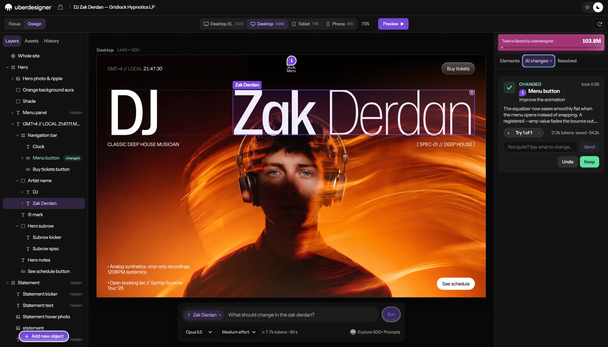

<h1 align="center">uberdesigner studio</h1>

<p align="center">
  <strong>Change your website's design one part at a time, with Claude, for 3 to 5× fewer tokens.</strong>
</p>

<p align="center">
  A Claude Code skill that turns a site into layers you can click, tweak and change,<br>
  in an editor that runs on your own computer.
</p>

<p align="center">
  <a href="docs/editor.md"><strong>Guide</strong></a> &nbsp;·&nbsp;
  <a href="#the-numbers"><strong>The numbers</strong></a> &nbsp;·&nbsp;
  <a href="https://discord.gg/CuyTccfBg3"><strong>Discord</strong></a> &nbsp;·&nbsp;
  <a href="https://uberdesigner.ai"><strong>uberdesigner.ai</strong></a> &nbsp;·&nbsp;
  <a href="https://x.com/bch1601"><strong>@bch1601 on X</strong></a>
</p>

## Install

```bash
git clone https://github.com/bogdan239/uberdesigner-studio ~/.claude/skills/uberdesigner-studio
```

Then open your site's folder in Claude Code and say:

```text
set up uberdesigner studio
```

Claude maps the site, installs the editor and gives you a link to open.



## What it does

- **Click a part of your site to pick it.** Headline, button, photo, section: each is a layer, listed like in a design
  file.
- **Tweak it live.** Sizes, colours, fonts, spacing, timing and easing curves have sliders and pickers. Save writes
  the values into your own code.
- **Type over any text** on the page. It goes straight into the file.
- **Ask Claude to change that one part.** The request carries only the part's code, so it is fast and small. The
  result arrives as a card: keep it, undo it, or ask again.
- **Go back any time.** Every change is a version in History.

It works on a phone, tablet, desktop or large-monitor size of your site, side by side with the layers.

## Setting it up

It needs Claude Code and Node.js on your computer. Setup checks both first and walks you through anything that is
missing, one command at a time.

**The best moment is right after Claude builds a site, in the same conversation.** Claude offers it by itself, and
setup then costs about a third of doing it later (182k tokens against 529k on two sister test sites), because
Claude already knows the site.

## Updating

In Claude Code, say:

```text
update uberdesigner studio
```

Claude checks GitHub for a newer version and, if there is one, gives you the one command that downloads it. Then it puts the new
editor into the site you have open. Your map, History and change cards stay as they are. Each of your other sites gets
the new editor when you say the same thing in its folder. What's new is in the [changelog](CHANGELOG.md).

## Works with

- **Sites with no build step:** one HTML page, plain HTML, CSS and JS files, a site with its own small Node server,
  or a page made as a claude.ai Artifact. This is what Claude Code builds when you ask for "a website": 16 of 16 in
  our test.
- **Vite + React + TypeScript** projects.

Not yet: Next.js, Astro, Nuxt, SvelteKit, Remix, Vite without React. On those, setup stops before it reads or writes
anything, and your site stays exactly as it was.

## The numbers

We made the same 15 everyday design changes two ways: through the studio, and by asking Claude Code directly in a
fresh copy of the site, with the same model.

| | Through the studio | Asking Claude Code directly |
|---|---|---|
| Tokens for one change, in a new conversation | **10.8k** | **55.6k** |
| Tokens for five changes, in one conversation | **58.7k** | **209.0k** |
| Tokens those five changes add to your conversation | **0** | **41.4k** |
| Time for one change | 8–32 s | 14–56 s |

That is 3 to 5× fewer tokens per change: 5.2× in a new conversation, 3.6× in one that already knows the project. And
a change through the studio adds nothing to your conversation, because it is a separate call outside your chat.

This is our own estimate from a small sample: 15 changes on three of our sites, drawn at random, on 18 November
2026, with Opus 5.5. Tokens are weighted the way usage is priced. Setup is not counted: it costs tokens once per
site. Results vary by project. The method, every number and the scripts are in
[How we measure the savings](docs/methodology.md) and on the repo's [`benchmark` branch](https://github.com/bogdan239/uberdesigner-studio/tree/benchmark/backtest), so you can run it yourself.

## How it works

1. **A map.** Claude reads your site, and its build prompt if there is one, and writes down its parts in
   `inspector.map.json`.
2. **Labels.** Each part's element gets a small `data-dm="hero-title"` label in your code, so the editor and Claude
   mean the same thing by "the headline".
3. **The editor.** It runs on localhost next to your site: open the site's address and it opens in the studio.
4. **A change.** Asking for one sends your request with only the pieces of code that part needs (its markup, its
   styles, the scripts that touch it, the design tokens) to your own Claude Code, in one small call. What comes back
   is applied, checked, and shown as a card.
5. **History.** Every version is kept in a private folder inside `.inspector/`. Your own git is never touched.

More in [How it works](docs/how-it-works.md) and [Using the editor](docs/editor.md).

## What it adds to your project

- **`.inspector/`**, ignored by git: the editor itself, History, and work files.
- **`data-dm` labels** on your elements, and **`inspector.map.json`**.
- **For Vite projects,** a few lines in `vite.config` that load the editor when it is there.

A fresh clone without `.inspector/` still builds, and a production build never includes the editor.

## What leaves your computer

The studio runs on your machine, and so does its server. Five things go out, and nothing else:

- **Changes you ask Claude for.** The studio runs your own Claude Code with the request and the pieces of code it
  needs. That goes to Anthropic under your Claude account, as any Claude Code request does.
- **The Google Fonts list.** When the font picker needs it, the server fetches the public list of families from
  `fonts.google.com` and keeps it for a week. No information about your site is sent.
- **A font you pick.** Your browser loads it from Google Fonts, as the site will once the font is saved.
- **An update you ask for.** "update uberdesigner studio" asks GitHub whether there is a newer version, and the
  command it gives you downloads it from there. Nothing about you or your site is sent.
- **The "Explore 500+ Prompts" link** opens uberdesigner.ai in a new tab, after asking, and only if you click it.

There is no analytics or telemetry in the studio.

## Good to know

**What does it cost?** The studio is free. Changes made by Claude use your own Claude plan. Tweaks, History and most
typed text use none of it.

**Do I need to know the terminal?** No. Setup shows each command with a button to run it, and says what it is for.

**Can I put it on a server for my team?** It is made for your own computer, with your own Claude account. Don't host
it for other people or send their requests through one account.

**What can't be clicked?** Objects drawn inside a canvas, such as a 3D scene. They can still be changed: pick them in
the layers list.

**My site changed outside the studio.** The editor says "The map is behind the site". Ask Claude Code to "update the
uberdesigner studio map".

**Old names.** The skill used to be called design-map and its editor the design inspector. What it puts in a site
keeps the old word (`.inspector/`, `inspector.map.json`), so sites set up before the rename keep working.

## Docs

- [Using the editor](docs/editor.md): everything in it, column by column.
- [How it works](docs/how-it-works.md): what a change sends, who can call the studio, what it writes and checks.
- [How we measure the savings](docs/methodology.md): the test behind the numbers, in full, and how to run it.
- [Measurements](docs/measurements.md): setup costs, what Claude Code builds by default, and the sites it was tested on.
- [Changelog](CHANGELOG.md): what changed, newest first.

For people changing the studio itself:

- [Contributing](CONTRIBUTING.md): how to send a bug or a change, and what to run first.
- [ARCHITECTURE.md](ARCHITECTURE.md): the pieces, how a change travels, and the rules the code keeps.
- [Internals](docs/internals.md): how a layer is found on the page, picked, and brought on screen.
- [Working on uberdesigner studio](docs/development.md): the folder, the stacks, the tests.
- [SKILL.md](SKILL.md): the steps Claude follows when it sets a site up.
- [Security](SECURITY.md): how to report a security problem.

## Why we built it

<!-- DRAFT: written from what the project says about itself. Replace with your own words. -->

We make design templates at [uberdesigner](https://uberdesigner.ai), and each one comes with the prompt that builds
it. Building a site from a prompt takes minutes. The afternoon after it goes to small things: this button bigger,
that headline lighter, the photo a little lower. Each of those sends the agent searching the whole project again.

We wanted the part of a design tool that works for this: click the thing, change the thing. And we wanted Claude to
get only the piece it needs, so a small change costs what a small change should.

## Community

- **Bugs, questions and ideas:** open an issue. A security problem goes [another way](SECURITY.md).
- **Prompts to build from:** the [uberdesigner library](https://uberdesigner.ai/library).
- **Discord:** [join the uberdesigner server](https://discord.gg/CuyTccfBg3). One click, and you don't need an
  account on uberdesigner.ai. Ask for help, show what you made, tell us what to build next.
- **What changed:** the [changelog](CHANGELOG.md). For news and what's next, follow
  [@bch1601](https://x.com/bch1601) on X.

## Licence

Copyright 2026 Advanced Design Technologies Ltd.

uberdesigner studio is open source under the [GNU Affero General Public License, version 3](LICENSE)
(AGPL-3.0-only). In short: you can use it, change it and share it, in commercial work too. If you give a changed
version to other people, or let them use one over a network, you offer them that version's source under the same
licence. The licence's own text is what counts, not this summary.

- **Your site stays yours.** Working on a site with the studio doesn't put the site under this licence. What you
  publish holds none of the studio's code, only the `data-dm` labels on your elements.
- **The credit stays.** Every shared version, changed or not, keeps the notice the editor shows: "uberdesigner
  studio. © 2026 Advanced Design Technologies Ltd." The exact term is in [NOTICE.md](NOTICE.md).
- **Contributions are welcome:** see [CONTRIBUTING.md](CONTRIBUTING.md). Before an outside contribution is merged, we ask its author to sign a contributor
  agreement, so that Advanced Design Technologies Ltd. can keep offering the studio under this licence and others.
- **The typeface** in the editor, Instrument Sans, is under the SIL Open Font License
  (`runtime/panel-src/fonts/OFL.txt`).
- **"uberdesigner"** and its logo are trademarks of Advanced Design Technologies Ltd. and aren't covered by the
  licence.

---

<p align="center">Made by <a href="https://x.com/bch1601">Bogdan Chechin</a> and the team behind <a href="https://uberdesigner.ai">uberdesigner</a>.</p>
